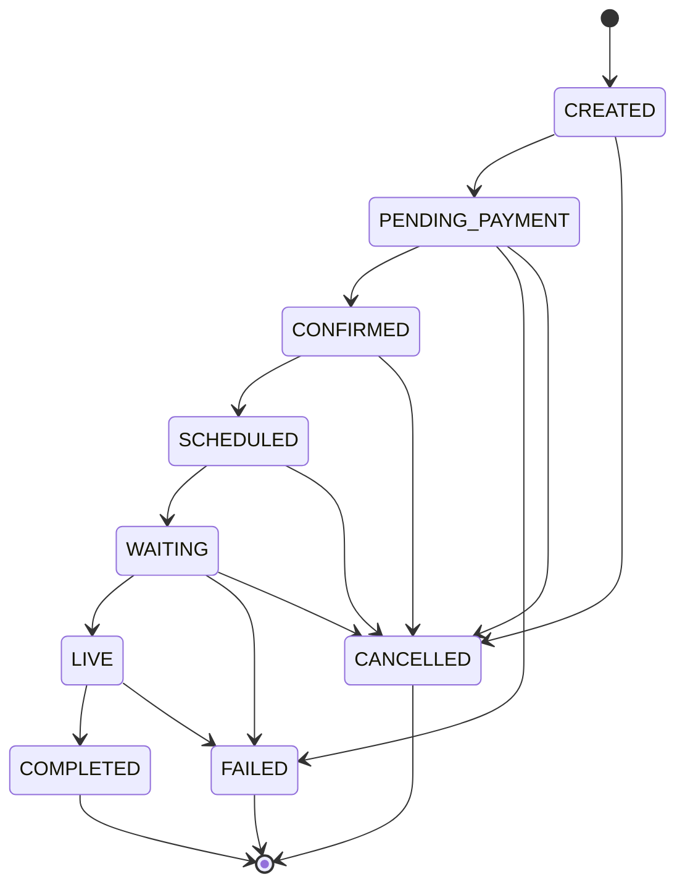

# Session State Machine (Phase 0 deliverable)

This table is enforced in code by `models/session.py::_ALLOWED_TRANSITIONS` —
any call to `Session.transition_to()` outside this table raises
`InvalidStateTransitionError`. See `person2-roadmap.pdf` Section 4 for the
full narrative (failure/edge-case rules, timeouts, reconnection behavior).
